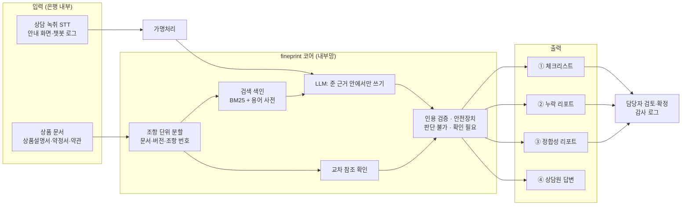

# 기업용 도입 제안서: 대출 설명의무 점검 에이전트

- **작성**: 전채아, 2026-11-03
- **대상**: 은행 소비자보호·여신 상품·디지털 채널 부서
- **전제**: 공개 자료(공시 약관·상품설명서, 법령, 감독 당국 발표)로 파악한 범위에서 쓴 제안이다. 금융사 내부 절차와 수치는 알지 못하므로, 그런 부분은 **가정**으로 표시하고 PoC에서 확인한다.
- **근거**: [콘셉트](concept.md) · [PRD](prd.md) · [설계 원칙](design-principles.md) · [평가](../eval/README.md) · [약관 수집에서 찾은 사례](../research/terms-sources.md)

## 1. 요약

> 소비자용 fineprint의 코어(조항 단위 검색, 근거 인용, 판단 불가, 교차 참조 확인)를 그대로 써서, 은행이 **대출 상품을 설명할 때 빠뜨린 중요 사항을 근거 조항과 함께 찾아 주는** 도구를 만든다.

| 모듈 | 하는 일 | 쓰는 사람 |
|---|---|---|
| ① 설명 항목 체크리스트 | 상품설명서·약정서·약관에서 설명해야 할 중요 사항을 조항 근거와 함께 뽑는다 | 상품 기획, 소비자보호 |
| ② 설명 누락 점검 | 상담 녹취 텍스트, 비대면 안내 화면, 챗봇 답변을 체크리스트와 맞춰 빠진 항목을 짚는다 | 소비자보호, 내부통제 |
| ③ 문서 정합성 점검 | 같은 상품의 문서끼리 다르게 적힌 조건, 맞지 않는 교차 참조를 찾는다 | 상품 기획, 법무 |
| ④ 상담원 근거 답변 | 상담원이 고객 질문을 물으면 조항 근거로 답하고, 문서로 정할 수 없으면 판단할 수 없다고 말한다 | 영업점·콜센터 상담원 |

PoC는 ①·③부터 시작한다. 고객 정보를 쓰지 않아 보안 심사 부담이 가장 작고, fineprint에서 이미 동작을 확인했다.

## 2. 현행 업무 분석

### 2.1 규제 요구

- 금융소비자보호법 제19조는 금융상품을 권유하거나 소비자가 설명을 요청하면 **중요한 사항을 소비자가 이해할 수 있도록 설명**하고, 설명서를 제공하고, 이해했음을 서명 등으로 확인받도록 정한다. 대출성 상품의 중요 사항에는 금리와 변동 여부, 중도상환수수료, 상환 방법, 연체 시 불이익(기한의 이익 상실 포함) 등이 들어간다.
- 위반하면 과태료와 함께 **해당 거래 수입의 최대 50%까지 과징금**이 부과될 수 있다. 소비자는 위법 계약 해지를 요구할 수 있다.
- 홍콩 H지수 ELS 사태에서 보듯 설명의무 위반은 배상, 과징금, 평판 손실로 함께 이어진다([머니투데이, 2024-05](https://www.mt.co.kr/finance/2024/05/29/2024052815312622089)). 대출은 투자상품보다 위험이 낮지만 판매 건수가 훨씬 많다.

### 2.2 지금 은행이 하는 일 (공개 자료로 본 것)

[앱 관찰](../research/app-observation.md)과 공시 문서로 확인한 것이다.

- **비대면**: 토스뱅크는 제19조의 설명 항목을 7단계 카드로 나누고 "충분히 이해하셨나요?"를 묻는다. 카카오뱅크는 상품설명서를 열어야 동의 버튼이 켜진다. 그러나 함께 넘어가는 문서는 133쪽, 217쪽이고, 동의는 버튼 하나다.
- **문서**: 한 상품에 상품설명서, 약정서, 기본약관이 층으로 있다. 같은 조건이 문서마다 다르게 적힌 곳이 있다.
  - 카카오뱅크 신용대출: 상품설명서는 "중도상환해약금 없음", 약정서에는 부과 조항이 있다(잔여 3개월 미만 면제).
  - 한 은행의 약정서가 기본약관의 다른 조를 가리키는 것으로 보이는 곳이 있었다([사례](../research/terms-sources.md#원문을-나눠-보고-알게-된-것)).
  - 은행마다 같은 내용의 조 번호가 다르다(대출계약 철회: 토스뱅크 제14조, 카카오뱅크 제13조, 하나은행 제4조의2).

### 2.3 가정: 은행 안에서 어려운 점

아래는 공개 자료와 일반적인 업무 구조로 추정한 것이다. PoC 첫 주 인터뷰에서 확인한다.

| 가정 | 확인 방법 |
|---|---|
| 설명 누락 점검은 녹취·화면을 **표본으로** 사람이 듣고 본다. 전수 점검은 어렵다 | 소비자보호 부서 인터뷰, 점검 주기·표본 비율 |
| 상품·약관이 바뀌면 설명 스크립트, 앱 화면, 챗봇 답을 사람이 맞춰 고친다. 일부가 늦게 반영된다 | 최근 약관 개정 1건의 반영 경로 추적 |
| 상담원은 고객의 예외 질문(연대보증, 일부 상환, 연체 후 부활 등)에 약관을 찾아 답하기 어렵다 | 콜센터 질문 상위 유형, 에스컬레이션 비율 |

## 3. 제안 솔루션

### 3.1 모듈별 동작

**① 설명 항목 체크리스트**

- 입력: 상품의 상품설명서·약정서·기본약관(PDF).
- 출력: 중요 사항 항목별로 `항목 | 이 상품의 내용 | 근거(문서·버전·조항·원문) | 상태(확인됨/문서 간 다름/근거 없음)`.
- fineprint의 "불리할 수 있는 조건 요약"(은행별 6줄)이 이 모듈의 원형이다. 18줄을 문서와 다시 대조했을 때 사람이 고칠 줄이 2개 나왔다. 그래서 **사람 검토 후 확정** 단계를 둔다(`reviewed` 표시는 이미 구현).

**② 설명 누락 점검**

- 입력: 상담 녹취의 STT 텍스트, 비대면 안내 화면 문구, 챗봇 답변 로그. **개인정보는 가명처리 후** 들어온다.
- 출력: 체크리스트 항목별 `설명함 / 빠짐 / 다르게 설명함` + 해당 발화 위치 + 근거 조항.
- "다르게 설명함"(예: 상담원은 "해약금 없어요", 약정서는 부과)이 가장 위험하므로 따로 표시한다.

**③ 문서 정합성 점검**

- 같은 상품의 문서끼리 같은 항목을 비교하고, 교차 참조("기본약관 제○조에 의해")가 가리키는 조의 제목·내용이 문맥과 맞는지 본다.
- fineprint에서 코드로 이미 하는 일이다(교차 참조 확인 → "확인 필요"). 약관 개정 때마다 돌리면 개정 전후 차이와 다른 문서에 남은 옛 내용을 찾는다.

**④ 상담원 근거 답변**

- fineprint의 "조항 근거 답변"을 그대로 쓴다. 답변, 확인 필요, 판단할 수 없음의 세 상태와 근거 원문을 보여 준다.
- 고객에게 직접 보이는 것이 아니라 **상담원 보조**다. 최종 설명은 상담원이 한다.

### 3.2 하지 않는 것

- 대출 심사, 한도·금리 산정, 상품 추천
- 상담원 평가나 인사 자료로 쓰는 것 (누락 점검 결과는 교육·스크립트 개선용으로 쓴다)
- 사람 검토 없는 자동 시정

## 4. 아키텍처

**핵심 설계**: LLM은 "준 근거 안에서 답 쓰기"만 한다. 검색, 교차 참조 확인, 인용 검증, 판단 불가 분류의 일부는 **코드**가 한다. 그래서 모델을 바꿔도 신뢰 장치가 그대로 남고, 모델이 근거에 없는 조항을 지어내면 코드에서 걸러진다.

### 4.1 모델 배치 선택지

| 선택지 | 장점 | 단점 | 맞는 모듈 |
|---|---|---|---|
| A. 내부망에 오픈 모델 설치 | 데이터가 밖으로 나가지 않음, 망분리 그대로 | GPU 비용, 답 품질이 낮을 수 있음 | ②(녹취) |
| B. 외부 상용 모델 API (규제 특례 범위 안) | 답 품질이 가장 좋음 | 망분리 특례·보안 심사 필요, 가명정보만 | ①③④ |
| C. 혼합: 공개 문서는 B, 고객 데이터는 A | 품질과 보안의 균형 | 운영 복잡도 | 권장 |

fineprint 평가에서 모델에 따른 차이가 컸다. 같은 파이프라인으로 72문항을 풀었을 때 Claude는 O 70, 무료 Gemini flash-lite는 안전장치를 붙여도 O 39였다([결과](../eval/results-gemini.md)). 모델 선택이 품질을 좌우하므로 **PoC에서 은행이 쓸 수 있는 모델로 같은 평가를 다시 돌려** 선택지를 정한다.

## 5. 보안 요건

| 영역 | 요건 | 대응 |
|---|---|---|
| 망분리 | 금융권은 내부 업무망과 인터넷망을 분리한다. 2024년 8월 금융위 「망분리 개선 로드맵」으로 혁신금융서비스(규제샌드박스)를 통해 가명정보의 생성형 AI 처리, 내부 시스템과 외부 AI 연결 특례가 열렸다([신&김 정리](https://shinkim.com/kor/media/newsletter/2533), [금융위](https://fsc.go.kr/po010101/82885)). 2026년 7월에는 일부 은행이 보안 목적 AI·SaaS 망분리 예외 실증에 선정됐다([딜사이트](https://dealsite.co.kr/articles/164691)) | 공개 문서만 다루는 ①③은 망분리 영향이 가장 작다. ②④에서 외부 모델을 쓰려면 특례 범위를 도입 시점에 다시 확인한다 |
| 개인신용정보 | 녹취·로그에는 이름, 연락처, 계좌, 소득이 섞인다 | 코어에 들어가기 전에 가명처리. 원문 녹취는 은행 시스템 밖으로 나가지 않는다 |
| 접근 권한 | 결과 리포트에도 상담 내용이 남는다 | 역할 기반 권한(상품 기획/소비자보호/상담원), 열람 기록 |
| 감사 추적 | 왜 그 답·판정이 나왔는지 재현할 수 있어야 한다 | 질문, 사용한 근거 조각, 모델·지시 버전, 결과를 함께 기록. fineprint는 이미 답마다 근거 조각과 버전을 남긴다 |
| 모델 위험 관리 | AI 결과의 정확도·편향을 주기적으로 검증해야 한다 | 은행 상품별 평가 질문셋과 함정 문항(문서 간 불일치, 판단 불가 질문)을 만들어 개정·모델 교체 때마다 회귀 평가 |
| 문서 버전 | 약관 개정 시 옛 문서로 답하면 안 된다 | 문서마다 시행일 기록, 답에 기준일 표시, 개정 시 ③ 자동 실행 |

## 6. PoC 계획 (8주)

| 주 | 할 일 | 산출물 |
|---|---|---|
| 1 | 인터뷰(소비자보호·상품·콜센터), 대상 상품 1개 선정, 2.3의 가정 확인 | 현행 업무 흐름도, 성공 기준 합의 |
| 2~3 | 대상 상품 문서 분할, 체크리스트 초안, 정합성 점검 | ①③ 결과 + 담당자 검토 |
| 4 | 은행 평가 질문셋 50문항(실제 상담 질문 기반, 함정 문항 포함) | 질문셋, 모델 선택지별 1차 결과 |
| 5~6 | ② 누락 점검: 가명처리된 과거 녹취 100건, 사람 점검 결과와 비교 | 일치율, 놓친 항목, 잘못 잡은 항목 |
| 7 | ④ 상담원 답변: 상담원 5명이 1주 사용 | 사용 로그, 설문 |
| 8 | 결과 정리, 확산 여부 판단 | PoC 보고서 |

**성공 기준 (PoC에서 합의할 초안)**

| 지표 | 기준 |
|---|---|
| ① 체크리스트 항목 정확도 (담당자 검토 기준) | 90% 이상 |
| ③ 문서 간 불일치 탐지 | 담당자가 아는 사례를 모두 찾고, 새 사례 1건 이상 |
| ② 누락 점검 재현율 (사람이 찾은 누락 대비) | 80% 이상, 오탐은 건당 검토 1분 이내로 처리 가능한 수준 |
| ④ 판단 불가 질문에 판단 불가 응답 | 90% 이상, 권유 표현 0건 |

## 7. 기대 효과

실제 수치는 은행 내부 자료가 있어야 계산할 수 있다. 아래는 계산 방식과 PoC에서 채울 값이다.

| 효과 | 계산 방식 | PoC에서 얻을 값 |
|---|---|---|
| 점검 범위 확대 | (자동 점검 건수 − 지금 표본 점검 건수) ÷ 전체 판매 건수 | 현재 표본 비율 |
| 점검 시간 절감 | 건당 점검 시간 × 연간 점검 건수 × 절감 비율 | 건당 시간, ② 검토 시간 |
| 개정 반영 지연 감소 | 약관 개정 후 화면·스크립트·챗봇이 모두 맞춰지기까지의 일수 | 최근 개정 1건의 반영 일수 |
| 상담 품질 | 예외 질문의 에스컬레이션 비율, 답변 시간 | 콜센터 지표 |
| 규제 위험 | 설명 누락·불일치를 판매 전에 찾은 건수 | ③에서 찾은 건수 |

**예시 (가정 값)**: 월 1만 건 대출 상담 중 1%를 사람이 점검하고 건당 15분이 걸린다면, 월 100건, 25시간이다. ②로 전수를 1차 거르고 "빠짐/다르게 설명함"만 사람이 보면, 같은 시간으로 훨씬 많은 상담을 볼 수 있다. 숫자는 가정이며 PoC 1주 차에 실제 값으로 바꾼다.

## 8. 위험과 한계

| 위험 | 대응 |
|---|---|
| AI 판정을 그대로 믿고 상담원을 제재 | 결과는 교육·스크립트 개선용으로만 쓴다고 PoC 전에 합의 |
| STT 오류로 잘못된 누락 판정 | 판정마다 원문 발화 위치를 붙여 사람이 바로 확인 |
| 답 품질이 모델에 좌우됨 | 은행 질문셋으로 모델별 회귀 평가, 기준 미달 모듈은 보조 기능으로만 |
| 해석이 갈리는 조항 | 판단 불가로 두고 법무 검토로 넘긴다. 단정하지 않는다 |
| 문서 범위 밖 질문 | "수집 문서에 없음, 확인 필요"로 표시 (fineprint에서 처음 보는 질문 14/14 표시) |

## 9. fineprint에서 이미 확인한 것

| 항목 | 결과 | 근거 |
|---|---|---|
| 근거 인용 정확도 | 100% (72문항, 5개 질문셋) | [results-v1.6](../eval/results-v1.6.md) |
| 답 정확도 (Claude) | 72문항 O 70 · △ 2 (AI 블라인드 채점, 3회 다수결) | [results-v1.6](../eval/results-v1.6.md) |
| 판단 불가·없는 문서 표시 | 처음 보는 85문항에서 26/26, 14/14. 과한 조심 4% | [results-guard](../eval/results-guard.md) |
| 문서 간 불일치·교차 참조 | 공시 문서에서 실제 사례 발견 | [terms-sources](../research/terms-sources.md) |
| 사용자 신뢰 | 근거 원문 신뢰 점수 중앙값 4/5 (1차 사용성 테스트) | [usability-results](../research/usability-results.md) |
| 한계 | 무료 모델은 답의 절반쯤이 요소를 빠뜨림. 사용자 테스트는 아직 소수·비경험자 | [results-gemini](../eval/results-gemini.md), [PRD](prd.md) |

은행 3곳, 문서 11개, 신용대출 하나에서 확인한 결과다. 은행 내부 문서와 상담 데이터에서도 같은 수준이 나오는지는 PoC에서 확인해야 한다.
